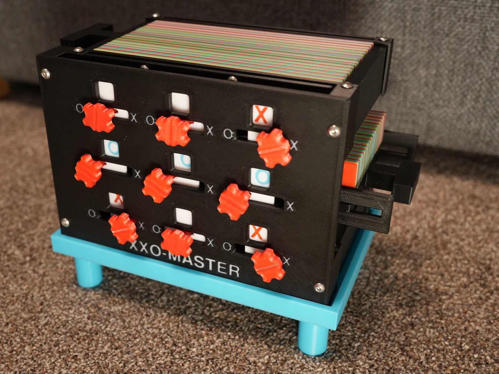

# XXO-Master: Unbeatable Mechanical Tic Tac Toe Machine



**XXO-Master** is a fully mechanical, 3D-printable Tic Tac Toe machine that has no electronics. It plays as the second player ('O') against a human 'X' and plays a perfect game, so it never loses. Its "brain" is a stack of 65 printed logic cards that drop and slide depending on the positions of the board rods. The cards encode a compressed lookup table of all 301 board states that can come up when O follows the table.

- 🖨️ **Printable files, print settings & assembly hints:** [Printables: Unbeatable Tic Tac Toe Machine "XXO-Master"](https://www.printables.com/model/1745561-unbeatable-tic-tac-toe-machine-xxo-master)
- 🎬 **How it works, explained in detail:** [YouTube video](https://www.youtube.com/watch?v=0ECLzEu6Fs4)

This repository contains everything used to design the machine:

| File | Purpose |
|---|---|
| `01_generate_moves.py` | Computes the optimal reply for 'O' for every reachable board state → `raw_moves.json` |
| `02_minimize_rules.py` | Compresses the raw table into a minimal set of wildcard rules (one rule = one card) → `minimized_rules.json` |
| `03_verify_rules.py` | Plays every possible game against the minimized rules to prove that 'O' never loses |
| `minimized_rules.json` | The 65 rules that are printed as cards on the machine (read by `ttt_machine.py`) |
| `ttt_machine.py` | [build123d](https://github.com/gumyr/build123d) CAD model of the whole machine (frames, rods, gears, knobs, stand and all 65 cards) |
| `fonts/` | Fonts used for the text on the parts (bundled for reproducible exports) |

## Part 1: The lookup table

The lookup table only covers reachable states. That means it only works if the game was played according to the table all along; you cannot use it to find the best move for an arbitrary board state.

The pipeline is split into three automated steps:

1. **`01_generate_moves.py`**: Searches the reachable game space to compute the minimal game tree of Tic Tac Toe. When several moves are equally optimal, it breaks the tie by subtree size. The result is a raw lookup table (`raw_moves.json`) that maps each board state ('X', 'O' or ' ' for blank) to an optimal reply move for 'O'.
2. **`02_minimize_rules.py`**: Compresses the raw lookup table into a minimal set of generalized rules in two phases:
   - **Pattern generalization (BFS)**: For each target move, it groups all base states that lead to that move and runs a breadth-first search that generalizes the states step by step using partial wildcards. A generalized pattern counts as valid only if it doesn't also match a board state that belongs to a different target move.
   - **Exact set cover (minimization)**: Using the `pulp` library, it models the problem as an integer linear program (ILP) and solves an exact set cover. This finds the smallest possible number of valid patterns that together cover all original base states. A small penalty in the objective function favors broader wildcards over narrower ones when breaking ties.

     *(Note: Exact set cover is NP-hard. Even though Tic Tac Toe is a fairly simple game, this step can take a few minutes. If you know a better or faster way to do this exact minimization, please let me know!)*

   To maximize compression, it uses the following wildcards:
   - `?` : matches any state ('X', 'O' or ' ')
   - `!` : matches "not 'O'" ('X' or ' ')
   - `*` : matches "not 'X'" ('O' or ' ')

   *(Note: There is no wildcard for "X or O" because that state can't be represented by a physical card in the machine.)*

   The final compressed table is exported to `minimized_rules.json`.

   *(Note: There are several different tables that are all equally minimal (65 rules), and the solver may return any one of them. `minimized_rules.json` in this repository is exactly the table used on the machine, in card-number order. Re-running step 2 may overwrite it with a different (but equally valid) table, and the card numbers would then no longer match the published STL files.)*
3. **`03_verify_rules.py`**: A lightweight verification script that plays every reachable game path against the minimized rules to make sure the compressed logic is 100% correct and free of conflicts.

## Part 2: The machine (CAD)

### How the machine works

**The board.** Each of the nine fields is a rod that runs from the front to the back of the machine. You move it with its knob on the front: left = O, center = empty, right = X. A magnet lets the rod snap into the center (empty) position, and spring clips in the mid frame hold it at the left and right ends. Gears rolling on racks keep its front and back ends in sync, and an indicator plate behind the cover window shows the X or O.

**The cards.** All 65 logic cards are stacked between the front and back frame, and all nine rods pass through every card. Each card is one rule from the lookup table. For each field, the card has a cutout with a vertical drop slot above every rod position that the rule allows. For an `X` there is one slot on the right; for a `!` (X or empty) there are slots on the right and in the center; for a `?` the whole cutout is open.

**Selecting a card.** After you have made your move as X, pull the release knob. A card can only drop if *all nine* rods are directly under one of its drop slots; a single rod in a different position holds it up. So only the card whose rule matches the current board drops, by 18 mm. (Sometimes two or three cards match the same board, but the lookup table guarantees that they all encode the same reply.)

**Making the reply.** Pushing the release knob back in pushes the dropped card to the left. The rods now sit in a horizontal channel at the top of each cutout. For eight fields this channel is wide enough for the card to slide past the rod. Only at the field of O's reply is the channel only as wide as the rod, so the card takes that rod along and moves it from the center to the O position. The machine has made its move. (In the script, `create_field_sketch()` builds these cutouts and `create_card()` turns one rule into a card.)

The [video](https://www.youtube.com/watch?v=0ECLzEu6Fs4) shows the mechanism in detail.

### The CAD script

`ttt_machine.py` is the parametric [build123d](https://github.com/gumyr/build123d) model of the machine. It reads the lookup table from `minimized_rules.json`, and each entry becomes one logic card (card *n* = the *n*-th entry in the file).

It was developed with build123d 0.11, and the gears are generated with [py_gearworks](https://github.com/GarryBGoode/py_gearworks). The script is written in cells (`# %%`). If [OCP CAD Viewer](https://github.com/bernhard-42/vscode-ocp-cad-viewer) (`ocp_vscode`) is installed, the assembled machine is shown in the viewer. The viewer is optional: without it the model is still built, and you can export it as described below.

### Exporting STL files

Pass flags on the command line (or set the `EXPORT_*` flags near the top of `ttt_machine.py` when running the cells interactively):

```bash
python ttt_machine.py --export          # all machine parts + full_assembly.stl
python ttt_machine.py --cards           # all 65 logic cards as STL (+ first_three_cards.3mf), takes a while
python ttt_machine.py --svg             # 2D outlines of all cards as SVG
```

The files are written to `export/` next to the script, already oriented for printing.

All text on the parts (card numbers, cover lettering, indicator plates) uses the fonts bundled in [`fonts/`](fonts/README.md), so the exported geometry is identical on every computer.

Ready-to-print files, print settings and the required hardware (M3 screws, 4×1 mm magnets) are listed on the [Printables page](https://www.printables.com/model/1745561-unbeatable-tic-tac-toe-machine-xxo-master).

### Easy reset (work in progress)

[`RESET_PLAN.md`](RESET_PLAN.md) describes a modification that lets a child reset the machine after a game: pull the release knob, lift a lever, push the knob in, knobs to the middle. It keeps all 65 cards and the lookup table unchanged. The CAD script already contains the parts for it (`create_top_left_rod` with a 5 mm lip, `create_lifter`, `create_lever` and the slot in `create_stand_platform`); the card holding rod is no longer part of the assembly. The checks behind the plan are in [`reset_mod/`](reset_mod/).

## Installation & usage

You'll need Python 3.10 or newer (the CAD script uses `match` statements). A virtual environment is recommended.

```bash
pip install -r requirements.txt
pip install ocp_vscode        # optional, for the 3D preview in VS Code
```

Run the lookup table pipeline:

```bash
python 01_generate_moves.py
python 02_minimize_rules.py   # only needed if you want to recompute the table, see the note above
python 03_verify_rules.py
```

Build or view the machine:

```bash
python ttt_machine.py         # or run the cells in VS Code with OCP CAD Viewer open
python ttt_machine.py --export --cards   # write all STL files to export/
```

## License

© 2026 Alex Krasno. This project (code, CAD model and data) is licensed under [CC BY-NC-SA 4.0](https://creativecommons.org/licenses/by-nc-sa/4.0/) (Attribution-NonCommercial-ShareAlike). You may share and modify it for non-commercial purposes if you give credit and share your changes under the same license. Selling the machine, its prints or derived designs is not allowed. See [LICENSE](LICENSE).
