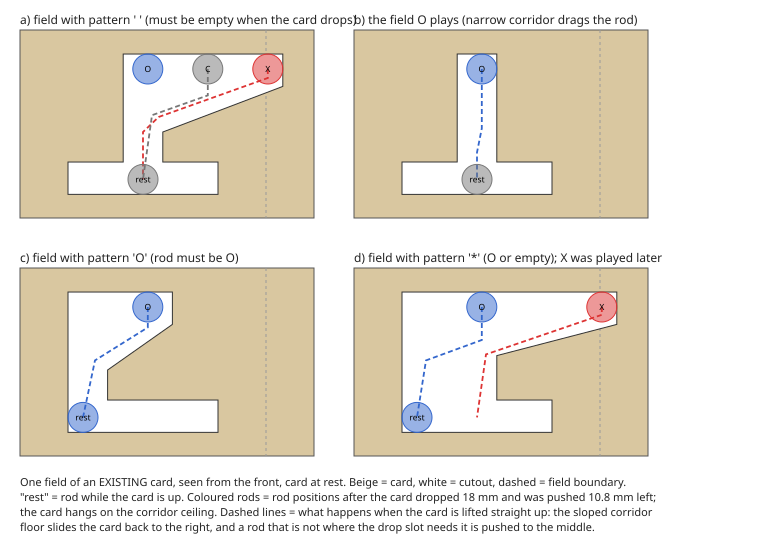
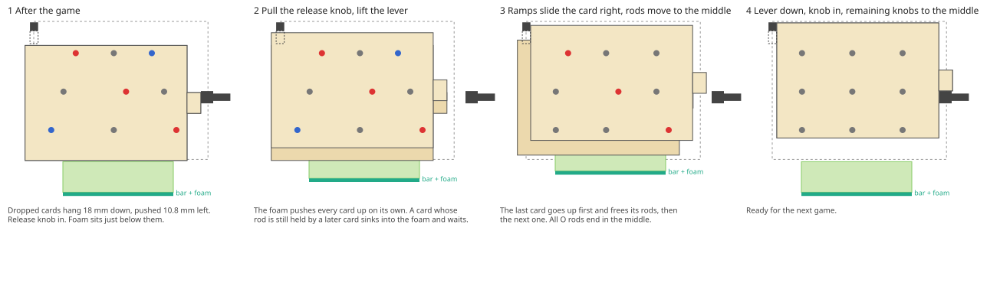

# Plan: an easy reset for the XXO-Master

Goal: after a game, a child resets the machine in a few obvious steps, without tipping it over, without knowing which card dropped when, and without being able to jam anything.

The surprising result of the analysis: **the 65 cards and the lookup table stay exactly as they are.** The cards already contain the geometry that does the work (the sloped corridor floor of every field). What is missing is a lifter that pushes every dropped card up *independently*, one small change to the top-left rod, and the removal of the card holding rod. The reset then is: pull the release knob, lift the lever, push the knob in, knobs to the middle.

Everything below was checked by simulation: [`reset_mod/check_reset_order.py`](reset_mod/check_reset_order.py) plays every possible game against the table and checks the lift at all 1279 points where a child might reset; [`reset_mod/check_lift_geometry.py`](reset_mod/check_lift_geometry.py) checks the 2D card geometry for every pattern character and rod position.

## 1. Why the reset is hard today

After a move, a card hangs 18 mm down and 10.8 mm to the left. To get it back up, three things have to happen, and they fight each other:

1. **Each card needs "its" board.** A card can only rise through its own drop slots, so the nine rods have to be where the card's rule allows. Fields that got an X or an O *after* the card dropped are in the way.
2. **Cards hold each other's rods.** A card that dropped later pins an O rod in its narrow corridor or in an `O` slot, exactly where an earlier card needs to push that rod back to the middle. The earlier card cannot move until the later one is up. If you push the earlier one first, the two jam. This is the "wrong order" problem.
3. **The card holding rod locks every dropped card** in its shifted position, so nothing can rise before it has been pushed back to the right by hand, and all of it is done against gravity.

Point 1 turns out to be solved already, point 2 is solved by the right kind of lifter, point 3 by removing the rod.

## 2. What the existing cards already do



Every field has a sloped corridor floor (the `Polygon` at the end of `create_field_sketch`, the point `(slot_width, -height_of_fall + slot_height + 5)`). When a dropped card is lifted *straight up* in its shifted position, the rods come down out of the corridor onto that slope. Because the slope always runs down towards the drop slot, two things happen by themselves:

- the slope **slides the card back to the right** by 10.8 mm, so the rods line up with the slots again;
- a rod that is **not where the slot needs it is pushed to the middle**: an X played later into an empty (`' '`) or `*` field is pushed from X to the centre, an O played later into an empty or `!` field is pushed from O to the centre, and the card's own move (the O it made) is dragged back to the centre by the wall of its drop slot.

Rods that the rule pins (`X` and `O` characters) stay where they are. The geometry check confirms a path for all 15 combinations of pattern character and rod position, and shows that the card is forced back to its rest position by the time it has risen 9.4 mm.

So after the lift the board holds only the X's that no card wanted to move; every O is back in the middle. The child moves the remaining X knobs to the middle at the end, in any order.

## 3. Why the order matters, and why a compliant lifter solves it

A card can only rise once every rod it has to push is free. A rod is held by a card that is still down when that card's rule has an `O` there (its corridor ends at the O side) or when it is that card's own move (narrow corridor). Both can only be *later* cards (the field was empty when the earlier card dropped). So the dependency always points the same way: **later cards first.** The latest card never waits for anybody, so there is always a card that can go up, and the simulation confirms that reverse drop order works in every game and that lifting "whatever is free" never deadlocks (up to 5 cards down at once; cards that dropped together on the same board rise together).

A rigid lifter bar cannot do this: the first blocked card stops the bar before the card that would free it has finished rising (that needs the full 18 mm). The lifter must push **each card independently with a limited force**: a strip of soft foam (or a printed TPU spring strip) on the bar. A free card rises on top of the foam; a blocked card sinks into it and waits, still pushed up with about 1 N; when the card holding its rod is up, it follows. The child only lifts the lever to the stop and holds it for a moment.



## 4. The modification

### 4.1 Top-left rod: shallower middle section (reprint one part)

The top-left rod is the left stop for the cards at rest and reaches 15.7 mm below the top edge of the cards, so that a card that has dropped 18 mm can shift under it. A card that is lifted in its shifted position hits it after 2.7 mm. The ramps need 9.4 mm of lift before the card is back at its rest position.

`create_top_left_rod` now cuts the rod down to a **5 mm lip** (`top_left_rod_lip_height`) between the two frame plates; inside the rod holders it keeps its full height, and the T-shaped grip on the outside is reduced to the same 5 mm. A card that is still shifted passes under the lip until it has risen 6.7 mm from its rest position, 2.7 mm more than the 9.4 mm of lift the ramps need (the card is unshifted at a height of 9.4 mm below rest, the lip starts at 6.7 mm below rest). A card at rest is still stopped by the lip. (The cards are also locked sideways at rest by any X rod against the end of its rail, so the lip is a second safety only.)

Alternative, if reprinting the rod is not wanted: a 12 × 9 mm notch in the top-left corner of every card, which can be cut into the existing cards by hand. The rod version is preferable.

### 4.2 Remove the card holding rod

Its slot in the card closes 1.6 mm above the rod, so it blocks every lift. During the game it is not needed: a dropped card is held in its shifted position by the release rod (the tab sits 0.1 mm from the release rod body) and by its own O rod sitting in the spring clip. Pull the rod out of the frames when the stand is swapped (it runs through both frames behind the mid frames, so the back mid frame comes off once). Leave `create_card_holding_rod` out of the assembly and the export list; the frame cut-outs are harmless. The small slot in the cards is harmless too.

### 4.3 Reset stand with a compliant lifter (modelled: `create_stand_platform`, `create_lifter`, `create_lever`)

- **Lifter** (`create_lifter`): a 70 × 6 × 4 mm bar running along the stack between the two frame plates under the middle of the cards, with two 0.8 mm rails on top that locate a **soft strip 20 mm tall** (firm open-cell foam, or a printed TPU zigzag strip; not printed with the bar). Two legs and two foot pads below. At rest the top of the strip sits 1 mm below the bottom edges of the dropped cards, 0.4 mm below the platform surface, in a 7 × 72 mm slot in the platform floor. Four short ribs under the floor guide the ends of the bar.
- **Lever** (`create_lever`): a 6 mm shaft along the stack in two bearing bosses under the platform, 20 mm to the right of the bar, with two arms of 19 mm radius under the foot pads and a 45 mm handle in front of the stand, 14 mm in front of the knobs and below the bottom row of knobs when raised. Lifting the handle from horizontal to vertical raises the lifter by **19 mm** (the stroke); a stop block under the platform catches the arm at vertical, a small rest in front of the platform holds the handle horizontal when released. Return by gravity. The stand legs grow from 30 to 48 mm to make room.
- **Stroke end**: at the top the strip just touches the bottom edges of the cards that never dropped (they hang on their rods), so the lever never compresses foam under 60 cards; only the cards that are still down load the foam. A card waiting for a later one sinks up to 13 mm into the strip.
- **Force window**: about 0.7 to 1.5 N per card at 12 mm compression. Enough to push a rod out of its spring clip through the ramp (the ramp gives a 2.6:1 advantage, the clip needs roughly 1 to 2 N), and far below what a 1 mm card wall holds. Tune by foam choice with the 3-card test in section 6.
- **Release knob**: the lift only works with the release knob pulled out (the shifting tab would otherwise run into the release rod). With the knob in, the lever simply stops after a few millimetres and nothing is harmed. A mechanical interlock is possible (a flag on the release rod handle that blocks the lever), but the step is the same motion children already make before every move.
- Checked in the model: no overlap between platform, lifter and lever at rest and at 20°, 45°, 70° and 90° of lever travel; the arm reaches the stop at 90°; nothing hangs below the stand legs.


### 4.4 Unchanged

All 65 cards, `minimized_rules.json` and the three scripts, both main frames, both mid frames, cover, indicator plates, the nine move rods, gears, racks, knobs, magnets, spring clips, release rod, the other three corner rods. The stand legs keep their shape but are printed 48 mm long instead of 30 mm.

## 5. The new reset

1. **Pull the release knob out.**
2. **Lift the lever to the stop and hold it for a moment.** The cards come up one after another, slide back to the right and put their O rods back in the middle.
3. **Let the lever down, push the release knob in.**
4. **Put the remaining knobs in the middle**, in any order.

No step depends on which card dropped when. If a knob is moved before the lift, nothing breaks: an X knob moved to the middle is dragged back by the card that needs it; only an O knob of a card that is still down should be left alone until the lift is done (the simulation and the geometry both rely on the O rods being where the cards left them).

## 6. Verification and test plan

Done by simulation:

```bash
pip install shapely
python reset_mod/check_reset_order.py     # all games, all reset points: order and deadlock
python reset_mod/check_lift_geometry.py   # all pattern/rod combinations: lift paths, rest-x height
```

To be done on the machine, in this order:

1. Pull out the card holding rod. Play a game, then try the reset by hand: pull the release knob and push the dropped cards up from the open bottom one at a time, **latest first**. They should slide right and put their O rods back without any knob being touched. This proves section 2 with the existing cards and nothing printed yet (the top-left rod will stop the card about 1.5 mm up: press the card gently to the right while lifting, or do this test with the rod pulled out).
2. Print the new top-left rod. Repeat the test without helping sideways.
3. Build the lifter with a candidate foam strip. Test with a game where three cards dropped: the lever should go to the stop, and the cards should come up within a second or two. If a card stays down, the foam is too soft; if the lever is hard to move or a card bends, it is too firm.
4. Print the stand, test the full procedure with a child, update the README and the Printables page.

## 7. What was considered and rejected

- **A universal reset channel in every field** (a slot where an X rod sits after the shift, so that "all knobs to X" would let every card rise). Any second channel between rail and corridor cuts the material between it and the drop slot loose: it becomes an island in a 1 mm card. Every bridge that could hold it would block a rod motion the game needs. Not buildable.
- **A lookup table that tolerates "all O knobs to the middle" before the lift** (no `O` characters, no `' '`/`*` where an X may be played later). It exists, but needs 152 cards instead of 65, more than the machine can hold.
- **A table without `X` and `O` characters** (so that "all knobs to the middle" would always work). Impossible: every state's pattern would also match the state two half-moves earlier, which needs a different move.
- **A fourth knob position** as a reset position: the 18 mm gears of neighbouring rods would collide, and frames, cover, racks and all cards would have to change.
- **Returning each card right after its move**: a card's own move field no longer matches the board once it has moved, so no passive geometry can bring it back during the game.

## 8. Risks and things to watch

- **Foam force window.** This is the one thing that cannot be simulated. The 3-card test in step 3 above settles it; a TPU spring strip with printed stiffness is the fallback if foam is inconsistent.
- **Friction of the shifting card.** Up to five cards slide 10.8 mm sideways between their neighbours while they rise; with clean prints this is well inside the ramp's advantage.
- **Top-left rod stiffness.** The 7 × 6.6 mm middle section spans 72 mm; it only has to stop cards (grams) and survive handling. If it feels flimsy, make it 8 mm tall (margin then 1.9 mm).
- **O knob moved early.** A card still down whose rule pins that O cannot rise until the knob is put back to O. The instructions therefore say: knobs only after the lever.
